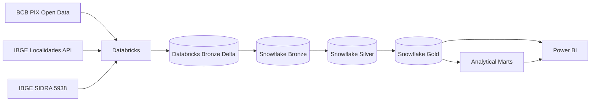
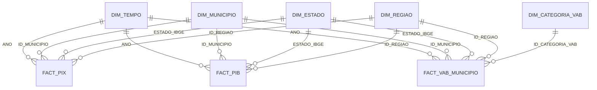

# PIX & Brazilian Economic Data Pipeline

End-to-end data engineering and analytics project that combines Brazilian PIX transaction data from the Banco Central do Brasil (BCB) with official geographic and municipal GDP data from IBGE.

The solution uses Databricks for extraction and orchestration, Snowflake as the analytical warehouse, and Power BI as the visualization layer.

## Project Goals

This project was designed to:

- ingest public PIX transaction data at municipality level;
- enrich financial data with official Brazilian geographic dimensions;
- ingest municipal GDP and Gross Value Added (VAB) data from IBGE SIDRA;
- implement a Bronze / Silver / Gold data architecture;
- support both historical and incremental processing;
- create reusable analytical marts for municipality, state, region, and PIX × GDP analysis;
- expose a dimensional model optimized for Power BI;
- demonstrate production-oriented practices such as secrets management, data-quality validation, idempotent reloads, and service-account authentication.

## High-Level Architecture



## Technology Stack

| Layer | Technology |
|---|---|
| Extraction | Python, Requests |
| Distributed processing | Databricks, PySpark |
| Lake layer | Delta tables |
| Data warehouse | Snowflake |
| Transformations | Snowflake SQL executed from Python |
| Orchestration | Databricks notebook pipeline |
| BI | Power BI |
| Authentication | Databricks Secrets, Snowflake Key Pair Authentication |
| Version control | Git / GitHub |

## Data Sources

### Banco Central do Brasil — PIX

PIX transaction data is retrieved from the BCB Open Data OData service and processed at municipality-month grain.

Historical PIX processing starts at `2020-11`.

The pipeline supports:

- `historico=true`: historical processing from `202011` through the current month (`M0`);
- `historico=false`: incremental processing focused on the current month (`M0`).

### IBGE Localidades

Official state and municipality metadata is retrieved from the IBGE Localidades API and used to build the geographic mapping:

```text
Municipality → State → Region
```

### IBGE SIDRA — Table 5938

SIDRA table `5938` is used for municipal GDP and VAB analysis.

| Variable ID | Description |
|---:|---|
| 37 | Gross Domestic Product at current prices |
| 543 | Net taxes on products |
| 498 | Total Gross Value Added |
| 513 | Agriculture Gross Value Added |
| 517 | Industry Gross Value Added |
| 6575 | Services Gross Value Added, excluding public administration |
| 525 | Public administration Gross Value Added |

The Bronze SIDRA dataset is stored in long format at `YEAR × MUNICIPALITY × VARIABLE` grain.

## Databricks Pipeline

The orchestration notebook is `pipeline_pix`.

It loads and executes three function-based notebooks in the same Python context:

```text
setup_snowflake
      ↓
extract_bcb
      ↓
load_snowflake
```

Main execution stages:

```text
01_SETUP_SNOWFLAKE
02_EXTRACT_BCB_IBGE_SIDRA
03_LOAD_SNOWFLAKE
```

The parent pipeline installs Snowflake dependencies once; child notebooks define reusable functions and emit logs in the parent context.

## Snowflake Architecture

Database: `PIX_DB`

Schemas:

```text
BRONZE
SILVER
GOLD
```

### Bronze

- `PIX_BCB_RAW`
- `IBGE_ESTADOS`
- `IBGE_MUNICIPIOS`
- `IBGE_MUNICIPIO_UF`
- `TRANSACOES_PIX_MUNICIPIO_RAW`
- `IBGE_SIDRA_5938_RAW`

### Silver

- `DIM_REGIAO`
- `DIM_ESTADO`
- `DIM_MUNICIPIO`
- `DIM_TEMPO`
- `FACT_PIX_MENSAL`
- `FACT_PIB_MUNICIPIO`

### Gold

Dimensions:

- `DIM_TEMPO`
- `DIM_MUNICIPIO`
- `DIM_ESTADO`
- `DIM_REGIAO`
- `DIM_CATEGORIA_VAB`

Facts:

- `FACT_PIX`
- `FACT_PIB`
- `FACT_VAB_MUNICIPIO`

Marts:

- `MART_PIX_MUNICIPIO_MENSAL`
- `MART_PIX_UF_MENSAL`
- `MART_PIX_REGIAO_MENSAL`
- `MART_PIX_PIB_MUNICIPIO_ANUAL`

## Gold Model



Geographic dimensions are intentionally independent in the Gold model. The facts carry municipality, state, and region keys directly to avoid ambiguous filter paths in Power BI.

## Fact Table Grains

| Table | Grain |
|---|---|
| `FACT_PIX` | Month × Municipality |
| `FACT_PIB` | Year × Municipality |
| `FACT_VAB_MUNICIPIO` | Year × Municipality × VAB Category |
| `MART_PIX_MUNICIPIO_MENSAL` | Month × Municipality |
| `MART_PIX_UF_MENSAL` | Month × State |
| `MART_PIX_REGIAO_MENSAL` | Month × Region |
| `MART_PIX_PIB_MUNICIPIO_ANUAL` | Year × Municipality |

## VAB Category Model

`FACT_PIB` remains wide for GDP-level calculations, while `FACT_VAB_MUNICIPIO` normalizes the four VAB components into rows:

```text
YEAR
MUNICIPALITY
VAB_CATEGORY
VAB_VALUE
```

Categories:

```text
Services
Industry
Public Administration
Agriculture
```

This allows `DIM_CATEGORIA_VAB` to act as a Power BI slicer.

## Data Quality

The pipeline validates:

- source and target row counts;
- temporary-table upload counts;
- five regions and 27 states;
- orphan keys between facts and dimensions;
- Silver-to-Gold fact parity;
- null analytical keys;
- time-dimension coverage;
- mart integrity;
- four VAB category rows per GDP fact row.

## Power BI

Recommended storage mode: `Import`.

Recommended relationships are `1:*`, single-direction, from dimensions to facts.

Use `DIM_TEMPO[ANO]` as a single-select year slicer and `DIM_CATEGORIA_VAB[CATEGORIA_VAB]` as the VAB category slicer.

Power BI Service uses a dedicated read-only Snowflake user with Key Pair Authentication.

## Security

Credentials are never hard-coded in the repository.

Databricks retrieves the Snowflake password from a secret scope:

```python
dbutils.secrets.get(
    scope="snowflake",
    key="password"
)
```

Never commit passwords, private keys, service-account files, access tokens, SAS tokens, or `.env` secrets.

## Repository Structure

```text
pix-ibge-data-pipeline/
├── README.md
├── requirements.txt
├── .gitignore
├── databricks/
│   ├── pipeline_pix.py
│   ├── setup_snowflake.py
│   ├── extract_bcb.py
│   └── load_snowflake.py
├── snowflake/
│   └── setup_pix_db.sql
├── docs/
│   ├── architecture.md
│   ├── data_model.md
│   ├── data_dictionary.md
│   ├── pipeline_execution.md
│   ├── data_quality.md
│   ├── power_bi.md
│   ├── security.md
│   ├── design_decisions.md
│   └── github_publish.md
└── powerbi/
    └── README.md
```

## Documentation

- [Architecture](docs/architecture.md)
- [Data Model](docs/data_model.md)
- [Data Dictionary](docs/data_dictionary.md)
- [Pipeline Execution](docs/pipeline_execution.md)
- [Data Quality](docs/data_quality.md)
- [Power BI](docs/power_bi.md)
- [Security](docs/security.md)
- [Design Decisions](docs/design_decisions.md)
- [GitHub Publishing Guide](docs/github_publish.md)

## Suggested Dashboard Pages

```text
01 — Economic Overview
02 — PIX Analysis
03 — PIX × GDP
```

## Disclaimer

This is a portfolio and educational data-engineering project built with public Brazilian government data. Source definitions, units, and methodological notes should always be interpreted according to the official BCB and IBGE metadata.
